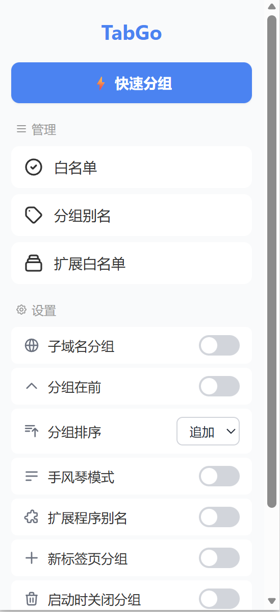
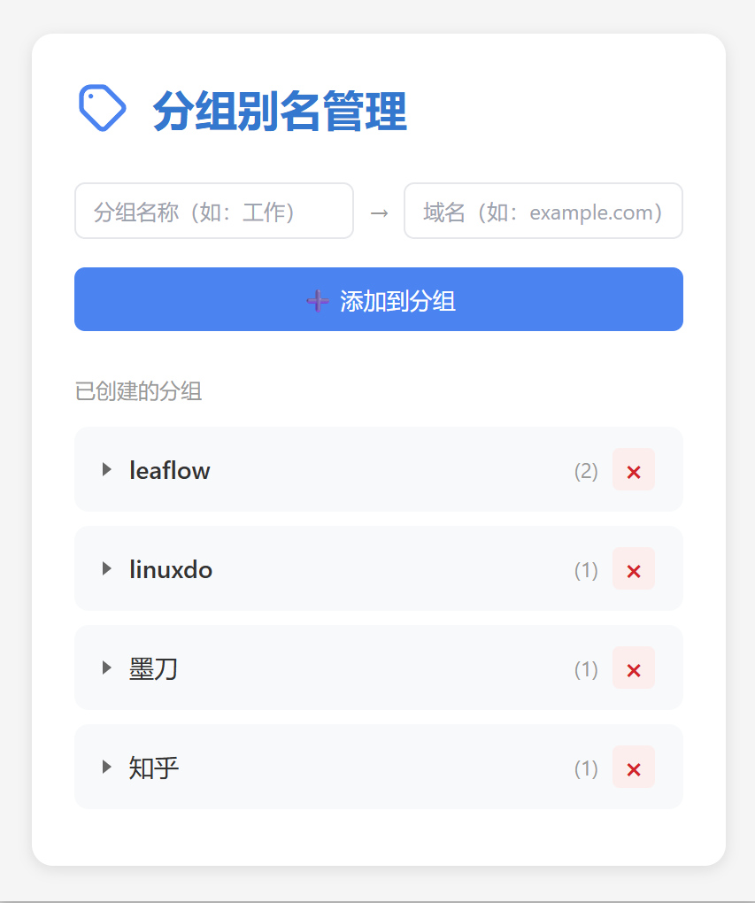

# TabGo

一个功能强大的 Chrome/Edge 浏览器标签页自动分组扩展，专为垂直标签页用户设计。

## 📖 项目简介

使用 Edge 浏览器时，习惯于垂直标签页布局，一直想找一个自动分组的扩展。找到的扩展不能完全满足需求，索性自己写了一个功能更全面的版本。

## ✨ 核心功能

### 自动分组
- **智能域名分组**：按根域名（正确处理 `com.cn`、`co.uk` 等后缀）或完整子域名自动分组
- **只改动需要改动的标签**：先计算目标状态再调用 API，频繁切换页面时不卡顿
- **尊重手动分组**：只会拆分 TabGo 自己建立的分组，不会打乱你手动创建的分组
- **固定标签不受影响**、**多窗口独立处理**、同名分组固定颜色
- **成组阈值**：同一网站达到 N 个标签才建组（默认 2）

### 规则管理（全屏控制台）
- **概览**：所有窗口的分组一览，可折叠/展开/取消分组、切换或关闭标签
- **分组规则**：多个域名归入一个分组；右侧列出“已打开的网站”，点一下即可设置
- **网站白名单**：后缀匹配（`google.com` 同时排除其子域名，但不会误伤 `xgoogle.com`），支持批量粘贴
- **扩展与特殊页**：控制扩展页面、新标签页是否参与分组；可用扩展名称代替扩展 ID
- **数据管理**：导出/导入全部配置（合并或覆盖），兼容 2.x 导出文件

### 快捷操作
- **弹窗**：显示当前网站所在分组，直接改分组名、加入/移出白名单；一键分组/折叠/展开/取消分组
- **右键菜单**：将网站加入白名单、为网站设置分组名称（跳转控制台并自动填好域名）、立即分组
- **页面内标签搜索**：默认双击 `Shift` 呼出，跨窗口搜索标题/网址/分组名，支持键盘切换与关闭标签
- **全局快捷键**：立即分组、打开控制台、打开标签搜索（在浏览器扩展快捷键页面中设置）
- **手风琴模式**：展开或切换到某个分组时自动折叠同窗口的其他分组

## 🛠️ 技术栈

| 组件 | 技术 |
|------|------|
| **扩展框架** | [WXT](https://wxt.dev)（Manifest V3，Vite 构建） |
| **界面** | Vue 3 + TypeScript + Tailwind CSS v4 |
| **页面内搜索** | 原生 TypeScript + Shadow DOM（保证每个网页的注入开销最小） |
| **浏览器** | Chrome / Edge（Chromium 内核，需支持 tabGroups API） |

## 📦 安装方法

### 下载发布版本

在 Releases 中下载 `tabgo-x.x.x-chrome.zip` 或 `tabgo-x.x.x-edge.zip`，解压后在 `chrome://extensions/` 或 `edge://extensions/` 打开“开发者模式”，点击“加载已解压的扩展程序”选择解压目录。

### 从源码构建

```bash
npm install
npm run build        # 产物：.output/chrome-mv3
npm run build:edge   # 产物：.output/edge-mv3
```

然后加载对应的 `.output/*-mv3` 目录。

### 开发模式

```bash
npm run dev        # 自动打开 Chrome 并热更新
npm run dev:edge   # Edge
```

## 📚 使用指南

1. 安装后标签页会自动按网站分组
2. 点击扩展图标：查看当前网站的分组，可直接修改分组名或加入白名单
3. 点击弹窗右上角“控制台”进入全屏管理页面，管理所有规则与设置
4. 在网页中双击 `Shift` 呼出标签搜索，`↑ ↓` 选择、`Enter` 切换、`Ctrl+Del` 关闭、`Esc` 退出

### 设置选项

| 选项 | 说明 |
|------|------|
| **按子域名分组** | 开启：`mail.google.com` 与 `drive.google.com` 分开成组；关闭：合并为 `google` |
| **成组的最少标签数** | 同一网站标签达到该数量才建组 |
| **分组排在最前** | 分组紧跟固定标签，未分组标签排在最后 |
| **分组排序** | 保持原位 / 按名称（中文 > 英文 > 数字）/ 新分组放末尾 |
| **手风琴模式** | 展开或切换到某个分组时折叠其他分组 |
| **浏览器启动时关闭已分组的标签** | 仅在浏览器启动时执行一次 |
| **新标签页参与分组** | 是否把新标签页合并成一组 |
| **用扩展名称作为分组名** | 扩展页面用扩展名称而不是 ID 作为分组名 |
| **页面内标签搜索 / 快捷键** | 开关与快捷键（双击修饰键或组合键） |

## 📁 项目结构

```
tabGo/
├── wxt.config.ts              # WXT 配置（manifest 在此生成）
├── public/icons/              # 扩展图标
└── src/
    ├── entrypoints/
    │   ├── background.ts      # Service Worker：分组调度、右键菜单、快捷键、消息
    │   ├── content/           # 页面内标签搜索（原生 TS + Shadow DOM）
    │   ├── popup/             # 弹窗（Vue）
    │   └── options/           # 全屏控制台（Vue），views/ 下为各个页面
    ├── components/            # 共享 Vue 组件
    ├── composables/           # useSettings（存储同步）、useBrowserTabs（实时标签）
    ├── utils/
    │   ├── settings.ts        # 存储键、默认值、读写工具
    │   ├── grouping.ts        # 分组规则解析（纯函数）
    │   ├── domain.ts          # 域名处理
    │   └── messages.ts        # 后台消息协议
    └── assets/                # 样式、TLD 列表、内置页面别名
```

## 🔧 开发说明

### 数据存储结构（与 2.x 兼容）

**chrome.storage.sync**（跨设备同步）：
```javascript
{
  "whitelist": ["example.com"],
  "groupNames": { "工作": ["github.com", "gitlab.com"] },
  "extensionWhitelist": ["<extension-id>", "newtab"]
}
```

**chrome.storage.local**：`subdomainEnabled`、`groupTop`、`groupSortMode`、`accordion`、`extensionReplace`、`clearGroupedTabs`、`enableNewtabGrouping`、`enableTabSearch`、`tabSearchKey`、`minGroupSize`，默认值见 `src/utils/settings.ts`。

### 分组流程

1. 事件（标签 URL 变化、关闭、拖动到其他窗口、设置变化）触发后，按窗口防抖 150ms 并串行执行
2. `resolveGroup()` 依次判断：白名单（后缀匹配）→ 自定义分组 → 内置页面别名 → 扩展页面 → 简化域名
3. 对比当前状态，只对需要移动的标签调用 `tabs.group` / `tabs.ungroup`
4. 开启“分组在前”或名称排序时，仅在顺序不符合预期时移动分组

## 📸 截图



## 🤝 贡献

欢迎提交 Issue 和 Pull Request！

## 📄 许可证

MIT License

## 🙏 致谢

感谢所有为这个项目提供建议和反馈的用户。
